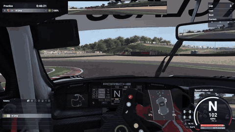

# Huriz - LMU Oversteer

*Formerly / antes: **LMU - Rear Slip Pro***

[English](#english) | [Español](#español) · [Changelog](CHANGELOG.md)

---

## English

A **SimHub plugin for Le Mans Ultimate** that drives your bass shakers when the rear wheels lose
grip (rear-end slides). It works together with **ShakeIt Bass Shakers**.

> **Version 0.3.1** works until **12/12/2026** (12 December 2026). After that
> the effect switches off. Feedback and bug reports are welcome in the *Issues* tab.

▶ [Watch the full video](media/demo.mp4) (3:45, with the settings and the drive)

### In short

- **What it is:** a SimHub plugin that makes your bass shakers vibrate when the rear of the car starts to slide in Le Mans Ultimate.
- **Install:** download the installer, close SimHub, run it and choose what to install. It creates the ShakeIt effect, and the Simagic haptic effect too if you have haptic pedals.
- **Overlay:** the installer also adds an overlay to Dash Studio (Overlays tab) that shows the live view over the game and combines with any other overlay.
- **Two settings are enough:** **Slip Start** (when it starts) and **Slip Max** (when it reaches 100%). **Pro** mode adds curve, anticipation, suspension, throttle limit and smoothing.
- **One setup per car:** save and load named setups with one click.
- **Everything explained below:** see the [Settings guide](#settings-guide).

**Contents:** [How it works](#how-it-works) · [Installation](#installation) · [Settings guide](#settings-guide) ·
[Tuning tips](#tuning-tips) · [Troubleshooting](#troubleshooting) · [For advanced users](#for-advanced-users)

### How it works

The plugin reads the telemetry of the two **rear tyres** from the game and measures their **slip angle**:
how many degrees each tyre is moving sideways compared with the direction it points.

1. While the car grips, the slip is small and nothing happens.
2. When **both** rear tyres slide past **Slip Start**, the effect switches on at a low level.
3. The more the rear slides, the stronger it gets, reaching 100% at **Slip Max**.
4. The result is sent to ShakeIt as two values, **rear left** and **rear right**, which drive your shakers.

Built-in protections (not configurable): it stays off below about 22 km/h, it is muted while the wheels are
spinning under power (wheelspin), and it switches off if the telemetry refresh is too slow.

### What it does

- Detects slip on both rear wheels, with anticipation and a wheelspin filter.
- Limits the effect by throttle and boosts it with suspension bounce.
- Settings tab with a **Simple** mode and a **Pro** mode, a **live view**, and **named setups per car**.
- An **overlay for Dash Studio** (Overlays tab) that shows the live view over the game.
- Creates the **Huriz - LMU Oversteer** effect in ShakeIt for you (50 Hz base, 60 Hz high, high priority).
- Optional effect for **Simagic haptic pedals**, on the throttle pedal (45 Hz base, 50 Hz high); you can change it in SimHub.
- English and Spanish interface.

### Requirements

- Windows 10 or 11.
- SimHub with ShakeIt Bass Shakers already set up (sound card and shakers).
- Le Mans Ultimate.

### Installation

1. Download `Huriz-LMU-Oversteer-Setup.exe` from the [latest release](../../releases/latest).
2. **Close SimHub** and run the installer (it asks for administrator rights and uses the language of Windows).
3. Choose your SimHub folder (the one that contains `SimHubWPF.exe`).
4. Choose what to install:
   - **Plugin** – always installed.
   - **Bass shaker effect** (ShakeIt Bass Shakers) – ticked.
   - **Simagic haptic effect** – only if SimHub has haptic pedals ("detected" in green, "not detected" in red).
     It is created on the throttle pedal only; you can change it later in SimHub (Devices > your pedals > Effects).
   - **Dash Studio overlay** – ticked.
5. Open SimHub and enable the **Huriz - LMU Oversteer** plugin when it asks.
6. In ShakeIt you will find the **Huriz - LMU Oversteer** effect. Check that the rear channels
   (Rear Left and Rear Right) are assigned to your shakers.

**Updating from LMU - Rear Slip Pro:** just run the new installer. It removes the old plugin and keeps your
settings, setups, effects, SimHub menu position and overlay layouts.

If you have never opened ShakeIt, open it once and run the installer again so it can create the effect.

Windows may show "Windows protected your PC" because the installer is not code-signed.
Click *More info* and then *Run anyway*.

### Overlay (Dash Studio)

The installer adds an overlay called **Huriz - LMU Oversteer** to SimHub, so you can see the live view over the game.

1. Open SimHub, go to **Dash Studio** and open the **Overlays** tab.
2. Find **Huriz - LMU Oversteer** and add it to your overlay layout, next to any other overlays you already use.
3. Place and size it as you like. SimHub manages its position and size.

In the plugin tab, the **Dash Studio overlay** card lets you turn the image on or off and choose a dark or fully
transparent background. It also tells you whether the template is installed.

The plugin draws the overlay as an image about 15 times per second while the game is running (once per second
otherwise). It only adds one template to SimHub: it never changes your existing overlay layouts.

### Settings guide

Open it from the **Guide** button in the plugin tab.

**The tab, from top to bottom**

- **Loaded profile** (green, next to the title) – the setup that is currently loaded.
- **Simple / Pro** – Simple shows only Slip Start and Slip Max. Pro adds the rest. Switching between them
  never loses your values, because both modes use the same settings.
- **ES / EN** – language of the tab. It follows Windows by default.
- **Guide** – opens this guide in your browser.
- **Live view** – shows what is happening while you drive. It has two cars on the same centre:
  the **light grey car** points where your wheels point (it follows your steering), and the
  **coloured-outline car** is how the car is really going. The coloured car turns the same angle as the grey
  one **plus** whatever it slides extra; that extra, in degrees, is written in the middle of the car and drawn as
  an arc. The two dots on each side of the arc mark your **Slip Start** and **Slip Max** (for example 3° and 12°).
  - **RL / RR numbers** (**TI / TD** in Spanish) – output of the rear left and rear right wheel in %.
    The rear wheels and the car outline go from grey to orange to red as the effect grows.
  - **ABS and TC** – the front axle lights up green with "ABS", and the rear axle with "TC", while they act.
  - **Road** – a curved road behind the cars. It bends the way you turn the wheel and its stripes move with speed.
  - **Expand** – shows only the live view, full size, with a **Close** button (Esc also closes it).

**Simple and Pro settings**

- **Slip Start (°)** – how much the rear tyres must slide sideways before the effect starts.
  Lower = it reacts earlier. Default 3°.
- **Slip Max (°)** – the slip at which the effect reaches 100%. Higher = a longer, more gradual build-up.
  Default 12°.
- **Progression curve** *(Pro)* – the shape between Slip Start and Slip Max. 1 = straight line.
  Below 1 the effect rises fast at first and flattens; above 1 it rises gently first and strongly at the end.
  Default 0.5.
- **Anticipation** *(Pro)* – a small amount of vibration (as % of the maximum) when slip grows quickly,
  just before the effect officially starts. A "heads-up" that the rear is about to go. Default 10%.
- **Suspension influence** *(Pro)* – extra boost from suspension bounce, up to the percentage you set.
  With 50% and a lot of bounce the output can rise up to x1.5. 0 = no boost. Default 50%.
- **Throttle limit** *(Pro)* – above this throttle the effect switches off, with a short fade of about 5%.
  100% = never. Handy if you don't want it during power oversteer. Default 100%.
- **Smoothing** *(Pro)* – how fast the vibration rises and falls when slip changes.
  **Fast** follows the car instantly and feels sharper, **Normal** is balanced, **Soft** is slower and rounder
  but a little delayed. It scales the rise and fall times: roughly 12/29 ms (Fast), 24/58 ms (Normal) and
  48/116 ms (Soft).
- **Road** – shows or hides the road behind the cars in the live view. It is in both Simple and Pro.
- **Slide direction** *(Pro)* – inverts which way the coloured-outline car swings. Choose **Inverted** if it
  swings the opposite way to the rear sliding. It only changes the live view.
- **Steering direction** *(Pro)* – inverts which way the grey car and the road turn. Choose **Inverted** if
  they turn opposite to your steering wheel. It only changes the live view.

**Buttons**

- **Reset to defaults** – puts every setting back to the recommended values (it keeps your mode and language).
- **Save settings** – saves the settings now. They are also saved when SimHub closes.

**Setups (per car)**

Save one set of settings for each car and load it with one click.

- Type a name and press **Save**: if the name doesn't exist it is created, if it exists it is overwritten.
- Click a setup in the list to load it. The loaded one turns blue. The list keeps a fixed order: Default first, then alphabetical.
- **Rename** edits the name in the list (Enter confirms, Esc cancels). **Delete** asks you to press twice.
- **Default** holds the recommended values. It can't be edited, renamed or deleted.
- A setup stores the plugin settings only. Sound card, shaker and volume live in ShakeIt.

### Tuning tips

1. Start with the defaults (Slip Start 3°, Slip Max 12°) and drive a few laps.
2. Effect starts too late or too early → move **Slip Start**.
3. Hard to feel the build-up (it seems to jump to full) → raise **Slip Max** and set the **curve** closer to 1.
4. Want to feel the very first moment more → lower **Slip Start** a little, or raise **Anticipation**.
5. Too nervous → **Smoothing: Soft**. Too slow → **Smoothing: Fast**.
6. In ShakeIt the created effect uses 50 Hz base and 60 Hz high; the tone moves toward the high frequency
   as the effect gets stronger. For a more audible build-up try a higher "High effect frequency"
   (for example 70 Hz). Below 50 Hz the slide is hard to read on most body shakers.
7. Watch the **Live view** while you tune: if the car swings but the percentages stay low, lower Slip Start.

### Troubleshooting

- **The effect is not in ShakeIt.** Open ShakeIt once, then run the installer again with SimHub closed.
  The installer never creates a second copy if it already exists.
- **No vibration.** Check that the plugin is enabled in SimHub, that the game is running, and that the
  rear channels of the effect are assigned to your shakers in ShakeIt. The live view should react when the
  rear slides.
- **The tab says this version expired.** This build stops working on its date. Download the latest release.
- **The car in the live view swings to the wrong side.** Tell us in *Issues*; it is a one-line fix.
- **"Windows protected your PC".** The installer is not code-signed. Click *More info* and *Run anyway*.
- **The overlay is not in Dash Studio.** Close SimHub and run the installer again with the Dash Studio option ticked. The plugin tab says whether the template is installed.
- **The overlay is empty or frozen.** Check that **Overlay image** is **On** in the plugin tab and that the game is running.
- **The installer says SimHub is open.** Close SimHub completely (also from the tray icon) and continue.

### For advanced users

Properties published by the plugin (search "HurizOversteer" in SimHub):

| Property | Meaning |
|---|---|
| `RL`, `RR` | Output for the rear left and rear right shaker (0-100) |
| `Expiry.DaysLeft` | Days left until this version expires, or -1 if the build has no limit |
| `Debug.Rate` | New telemetry readings per second |
| `Debug.SlipRL/RR` | Slip angle per rear wheel (degrees) |
| `Debug.GateRL/RR` | Effect gate open |
| `Debug.TargetRL/RR` | Intensity before smoothing |
| `Debug.Progress`, `Debug.Rise` | Progress (0-100) and slip growth (degrees/s) |
| `Debug.Steering` | Steering wheel, from -1 to 1 |
| `Debug.ABS`, `Debug.TC` | ABS / traction control acting |
| `Overlay.Image` | Path of the latest overlay image (used by the Dash Studio template) |

The effect created in ShakeIt is a Custom effect that simply returns
`$prop('HurizOversteerPlugin.RL')` and `$prop('HurizOversteerPlugin.RR')` for the rear left and rear right channels.

### Uninstall

Use *Settings > Apps* in Windows. The ShakeIt effect is not removed automatically:
delete it from ShakeIt if you no longer want it.

### License

Copyright (c) 2026 Huriz. All rights reserved. You may use this software for personal use.
Redistribution and modification are not allowed.

---

## Español

Plugin de SimHub para **Le Mans Ultimate** que genera vibración en los bass shakers cuando
las ruedas traseras pierden agarre (derrape de la zaga). Funciona junto a **ShakeIt Bass Shakers**.

> **Versión 0.3.1.** Esta versión funciona hasta el **12/12/2026**. Después el efecto
> se desactiva. Los comentarios y fallos son bienvenidos en la pestaña *Issues*.

▶ [Ver el vídeo completo](media/demo.mp4) (3:45, con los ajustes y la conducción)

### En resumen

- **Qué es:** un plugin de SimHub que hace vibrar tus bass shakers cuando la zaga del coche empieza a irse en Le Mans Ultimate.
- **Instalar:** descarga el instalador, cierra SimHub, ejecútalo y elige qué instalar. Crea el efecto de ShakeIt, y también el efecto háptico de Simagic si tienes pedales hápticos.
- **Overlay:** el instalador añade también un overlay a Dash Studio (pestaña Overlays) que muestra la vista en vivo sobre el juego y se combina con cualquier otro overlay.
- **Con dos ajustes basta:** **Slip Start** (cuándo empieza) y **Slip Max** (cuándo llega al 100%). El modo **Pro** añade curva, anticipación, suspensión, límite de gas y suavizado.
- **Un setup por coche:** guarda y carga setups con nombre con un clic.
- **Todo explicado más abajo:** mira la [Guía de ajustes](#guía-de-ajustes).

**Contenido:** [Cómo funciona](#cómo-funciona) · [Instalación](#instalación) · [Guía de ajustes](#guía-de-ajustes) ·
[Consejos de ajuste](#consejos-de-ajuste) · [Problemas frecuentes](#problemas-frecuentes) · [Para usuarios avanzados](#para-usuarios-avanzados)

### Cómo funciona

El plugin lee del juego la telemetría de los dos **neumáticos traseros** y mide su **ángulo de deslizamiento
(slip)**: cuántos grados se mueve cada neumático hacia un lado respecto a la dirección a la que apunta.

1. Mientras el coche agarra, el slip es pequeño y no pasa nada.
2. Cuando **los dos** neumáticos traseros pasan de **Slip Start**, el efecto se activa con poca intensidad.
3. Cuanto más se va la zaga, más fuerte se vuelve, hasta el 100% en **Slip Max**.
4. El resultado se envía a ShakeIt como dos valores, **trasera izquierda** y **trasera derecha**, que mueven tus shakers.

Protecciones incluidas (no configurables): se mantiene apagado por debajo de unos 22 km/h, se silencia cuando las
ruedas patinan por potencia (wheelspin) y se apaga si el refresco de la telemetría es demasiado lento.

### Qué hace

- Detecta el deslizamiento de las dos ruedas traseras, con anticipación y filtro de wheelspin.
- Limita la vibración según el gas y la refuerza con el bote de la suspensión.
- Pestaña de ajustes con modo **Simple** y modo **Pro**, una **vista en vivo** y **setups con nombre por coche**.
- Un **overlay para Dash Studio** (pestaña Overlays) que muestra la vista en vivo sobre el juego.
- Crea solo el efecto **Huriz - LMU Oversteer** en ShakeIt (50 Hz base, 60 Hz alta, prioridad alta).
- Efecto opcional para **pedales hápticos Simagic**, en el acelerador (45 Hz base, 50 Hz alta); puedes cambiarlo en SimHub.
- Interfaz en español e inglés.

### Requisitos

- Windows 10 u 11.
- SimHub con ShakeIt Bass Shakers configurado (tarjeta de sonido y shakers).
- Le Mans Ultimate.

### Instalación

1. Descarga `Huriz-LMU-Oversteer-Setup.exe` desde la [última release](../../releases/latest).
2. **Cierra SimHub** y ejecuta el instalador (pide permisos de administrador y usa el idioma de Windows).
3. Elige la carpeta de SimHub (la que contiene `SimHubWPF.exe`).
4. Elige qué instalar:
   - **Plugin** – siempre se instala.
   - **Efecto para bass shakers** (ShakeIt Bass Shakers) – marcado.
   - **Efecto háptico de Simagic** – solo si SimHub tiene pedales hápticos ("detectado" en verde, "no detectado" en rojo).
     Se crea solo en el pedal del acelerador; puedes cambiarlo después en SimHub (Dispositivos > tus pedales > Efectos).
   - **Overlay de Dash Studio** – marcado.
5. Abre SimHub y activa el plugin **Huriz - LMU Oversteer** cuando lo pida.
6. En ShakeIt aparecerá el efecto **Huriz - LMU Oversteer**. Comprueba que los canales traseros
   (Rear Left y Rear Right) están asignados a tus shakers.

**Si vienes de LMU - Rear Slip Pro:** basta con ejecutar el instalador nuevo. Quita el plugin viejo y conserva tus
ajustes, setups, efectos, posición en el menú de SimHub y diseños de overlays.

Si nunca has abierto ShakeIt, ábrelo una vez y vuelve a ejecutar el instalador para que cree el efecto.

Windows puede mostrar el aviso "Windows protegió su PC", porque el instalador no está firmado.
Pulsa *Más información* y luego *Ejecutar de todas formas*.

### Overlay (Dash Studio)

El instalador añade a SimHub un overlay llamado **Huriz - LMU Oversteer**, para ver la vista en vivo sobre el juego.

1. Abre SimHub, entra en **Dash Studio** y abre la pestaña **Overlays**.
2. Busca **Huriz - LMU Oversteer** y añádelo a tu diseño de overlays, junto a los demás que ya uses.
3. Colócalo y ajusta el tamaño como quieras. SimHub gestiona su posición y su tamaño.

En la pestaña del plugin, la tarjeta **Overlay de Dash Studio** permite activar o apagar la imagen y elegir un fondo
oscuro o totalmente transparente. También te dice si la plantilla está instalada.

El plugin dibuja el overlay como una imagen unas 15 veces por segundo con el juego en marcha (una vez por segundo
si no). Solo añade una plantilla a SimHub: nunca cambia tus diseños de overlays.

### Guía de ajustes

Ábrela desde el botón **Guía** de la pestaña del plugin.

**La pestaña, de arriba abajo**

- **Perfil cargado** (verde, junto al título) – el setup que está cargado ahora.
- **Simple / Pro** – Simple muestra solo Slip Start y Slip Max. Pro añade el resto. Cambiar de uno a otro
  no pierde tus valores, porque los dos modos usan los mismos ajustes.
- **ES / EN** – idioma de la pestaña. Por defecto sigue el de Windows.
- **Guía** – abre esta guía en el navegador.
- **Vista en vivo** – muestra lo que pasa mientras conduces. Tiene dos coches sobre el mismo centro:
  el **coche gris claro** apunta hacia donde apuntan tus ruedas (sigue el volante) y el
  **coche con contorno de color** es cómo va realmente el coche. El de color gira el mismo ángulo que el gris
  **más** lo que se va de más; ese extra, en grados, sale escrito en el centro del coche y dibujado como un arco.
  Los dos puntos a cada lado del arco marcan tu **Slip Start** y tu **Slip Max** (por ejemplo 3° y 12°).
  - **Números TI / TD** (**RL / RR** en inglés) – intensidad de la rueda trasera izquierda y derecha en %.
    Las ruedas traseras y el contorno del coche pasan de gris a naranja y a rojo según crece el efecto.
  - **ABS y TC** – el eje delantero se ilumina en verde con "ABS", y el trasero con "TC", mientras actúan.
  - **Carretera** – una carretera curva detrás de los coches. Se curva hacia donde giras el volante y sus rayas
    avanzan con la velocidad.
  - **Ampliar** – muestra solo la vista en vivo, en grande, con un botón **Cerrar** (Esc también la cierra).

**Ajustes de Simple y Pro**

- **Slip Start (°)** – cuánto tienen que deslizar de lado las ruedas traseras para que empiece el efecto.
  Más bajo = reacciona antes. Por defecto 3°.
- **Slip Max (°)** – el slip con el que el efecto llega al 100%. Más alto = una subida más larga y gradual.
  Por defecto 12°.
- **Curva de progresión** *(Pro)* – la forma entre Slip Start y Slip Max. 1 = línea recta.
  Menos de 1: sube rápido al principio y se aplana. Más de 1: sube suave al principio y fuerte al final.
  Por defecto 0,5.
- **Anticipación** *(Pro)* – una pequeña vibración (en % del máximo) cuando el slip crece rápido, justo antes de
  que empiece el efecto. Es un aviso de que la zaga está a punto de irse. Por defecto 10%.
- **Influencia de suspensión** *(Pro)* – refuerzo extra por el bote de la suspensión, hasta el porcentaje que
  pongas. Con 50% y mucho bote la salida puede subir hasta x1,5. 0 = sin refuerzo. Por defecto 50%.
- **Límite de gas** *(Pro)* – con más gas que este valor el efecto se apaga, con una transición corta de
  un 5%. 100% = nunca. Útil si no lo quieres durante el sobreviraje por potencia. Por defecto 100%.
- **Suavizado** *(Pro)* – con qué rapidez sube y baja la vibración cuando cambia el slip.
  **Rápido** sigue al coche al instante y es más seco, **Normal** es equilibrado, **Suave** es más lento y
  redondo pero con un pequeño retraso. Escala los tiempos de subida y bajada: aproximadamente 12/29 ms (Rápido),
  24/58 ms (Normal) y 48/116 ms (Suave).
- **Carretera** – muestra u oculta la carretera que va detrás de los coches en la vista en vivo. Está en Simple y en Pro.
- **Sentido del derrape** *(Pro)* – invierte hacia qué lado gira el coche con contorno de color. Elige **Invertido**
  si gira al lado contrario al que se te va la zaga. Solo cambia la vista en vivo.
- **Sentido del volante** *(Pro)* – invierte hacia qué lado giran el coche gris y la carretera. Elige **Invertido**
  si giran al revés que tu volante. Solo cambia la vista en vivo.

**Botones**

- **Restablecer valores** – devuelve todos los ajustes a los valores recomendados (mantiene tu modo e idioma).
- **Guardar configuración** – guarda los ajustes ya. También se guardan al cerrar SimHub.

**Setups (por coche)**

Guarda un ajuste para cada coche y cárgalo con un clic.

- Escribe un nombre y pulsa **Guardar**: si no existe se crea y si existe se sobrescribe.
- Haz clic en un setup de la lista para cargarlo. El cargado se pone en azul. La lista tiene un orden fijo: Default primero y el resto por orden alfabético.
- **Renombrar** edita el nombre en la propia lista (Intro confirma, Esc cancela). **Borrar** pide pulsar dos veces.
- **Default** tiene los valores recomendados. No se puede editar, renombrar ni borrar.
- Un setup guarda solo los ajustes del plugin. La tarjeta de sonido, el shaker y el volumen están en ShakeIt.

### Consejos de ajuste

1. Empieza con los valores por defecto (Slip Start 3°, Slip Max 12°) y da unas vueltas.
2. El efecto entra demasiado tarde o demasiado pronto → mueve **Slip Start**.
3. Cuesta notar cómo sube (parece que salta a tope) → sube **Slip Max** y acerca la **curva** a 1.
4. Quieres notar más el primer instante → baja un poco **Slip Start** o sube **Anticipación**.
5. Demasiado nervioso → **Suavizado: Suave**. Demasiado lento → **Suavizado: Rápido**.
6. En ShakeIt el efecto creado usa 50 Hz base y 60 Hz alta; el tono se acerca a la frecuencia alta cuando el efecto
   se hace más fuerte. Para una subida más audible prueba una "High effect frequency" mayor (por ejemplo 70 Hz).
   Por debajo de 50 Hz el derrape se nota poco en la mayoría de body shakers.
7. Mira la **Vista en vivo** mientras ajustas: si el coche se mueve pero los porcentajes se quedan bajos, baja Slip Start.

### Problemas frecuentes

- **El efecto no está en ShakeIt.** Abre ShakeIt una vez y vuelve a ejecutar el instalador con SimHub cerrado.
  El instalador nunca crea una segunda copia si ya existe.
- **No vibra.** Comprueba que el plugin está activado en SimHub, que el juego está en marcha y que los canales
  traseros del efecto están asignados a tus shakers en ShakeIt. La vista en vivo debería reaccionar cuando la
  zaga se va.
- **La pestaña dice que esta versión caducó.** Esta versión deja de funcionar en su fecha. Descarga la última release.
- **El coche de la vista en vivo se mueve hacia el lado contrario.** Avísanos en *Issues*; se corrige con una línea.
- **"Windows protegió su PC".** El instalador no está firmado. Pulsa *Más información* y *Ejecutar de todas formas*.
- **El overlay no sale en Dash Studio.** Cierra SimHub y vuelve a ejecutar el instalador con la casilla de Dash Studio marcada. La pestaña del plugin dice si la plantilla está instalada.
- **El overlay sale vacío o congelado.** Comprueba que **Imagen del overlay** está **Activa** en la pestaña del plugin y que el juego está en marcha.
- **El instalador dice que SimHub está abierto.** Cierra SimHub del todo (también desde el icono de la bandeja).

### Para usuarios avanzados

Propiedades que publica el plugin (busca "HurizOversteer" en SimHub):

| Propiedad | Significado |
|---|---|
| `RL`, `RR` | Salida para el shaker trasero izquierdo y derecho (0-100) |
| `Expiry.DaysLeft` | Días que quedan hasta que caduque esta versión, o -1 si la versión no tiene límite |
| `Debug.Rate` | Lecturas nuevas de telemetría por segundo |
| `Debug.SlipRL/RR` | Ángulo de slip de cada rueda trasera (grados) |
| `Debug.GateRL/RR` | Puerta del efecto abierta |
| `Debug.TargetRL/RR` | Intensidad antes del suavizado |
| `Debug.Progress`, `Debug.Rise` | Progreso (0-100) y crecimiento del slip (grados/s) |
| `Debug.Steering` | Volante, de -1 a 1 |
| `Debug.ABS`, `Debug.TC` | ABS / control de tracción actuando |
| `Overlay.Image` | Ruta de la última imagen del overlay (la usa la plantilla de Dash Studio) |

El efecto que se crea en ShakeIt es un Custom effect que devuelve simplemente
`$prop('HurizOversteerPlugin.RL')` y `$prop('HurizOversteerPlugin.RR')` para los canales trasero izquierdo y derecho.

### Desinstalar

Desde *Configuración > Aplicaciones* de Windows. El efecto de ShakeIt no se borra solo:
elimínalo desde ShakeIt si no lo quieres.

### Licencia

Copyright (c) 2026 Huriz. Todos los derechos reservados. Puedes usar este software para
uso personal. No se permite redistribuirla ni modificarla.